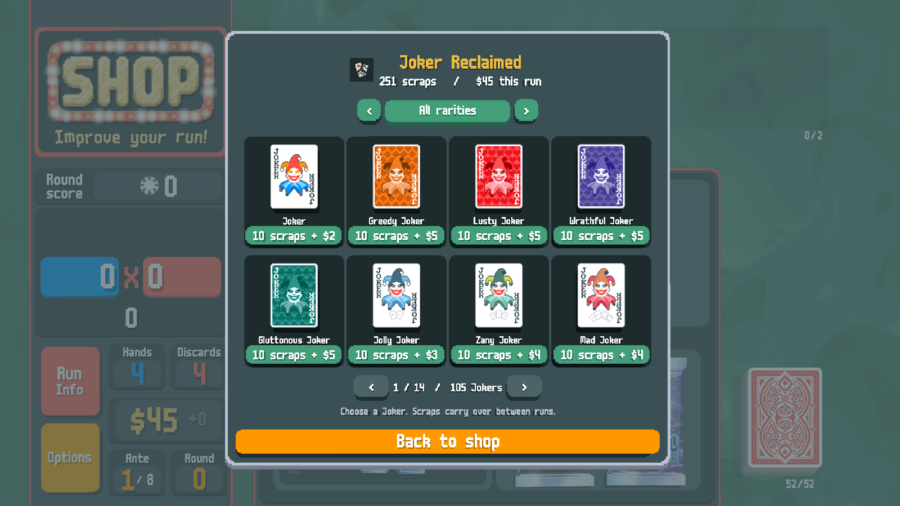

# Joker Reclaimed · 조커 복원소

Tear unwanted Jokers into permanent scraps, then restore the unlocked Joker you want. A Steamodded mod for Balatro with selectable stickers and editions, native card effects, and all 15 game languages.

필요 없는 조커를 찢어 영구 조각을 모으고, 해금한 원하는 조커를 복원하는 Steamodded 모드입니다. **이터널 조커는 찢을 수 없습니다.**

[Download 1.0.0](https://github.com/kmu9842/JokerReclaimed/releases/tag/v1.0.0) · [15 languages & illustrated guides](docs/LANGUAGES.md) · [한국어 상세 설명](JokerReclaimed/README.md)



## Install

1. Install [Lovely](https://github.com/ethangreen-dev/lovely-injector) and [Steamodded](https://github.com/Steamodded/smods).
2. Download `JokerReclaimed-1.0.0.zip` from Releases and extract its `JokerReclaimed` folder into your Balatro Mods directory. On Windows: `%APPDATA%\Balatro\Mods\`.
3. Restart Balatro. The metadata file should be at `Mods/JokerReclaimed/JokerReclaimed.json`.

Developed with Balatro **1.0.1o**, Steamodded **26.829.0**, and Lovely **0.10.0**. Only the mod is bundled; install its dependencies separately.

## Play

Select an owned Joker and click **Tear Joker**. Confirm to receive scraps that persist across runs and profiles; tearing gives no sale money or sell effects. In the shop, choose **Restore Joker** or press **F7**, select an unlocked Joker, then choose stickers and an edition before buying.

| Rarity | Scraps from tearing | Scraps to restore | Base dollars |
|---|---:|---:|---|
| Common | 1 | 10 | Normal shop price |
| Uncommon | 3 | 30 | Normal shop price |
| Rare | 7 | 60 | Normal shop price |
| Legendary | 20 | 100 | $10 |

Rental and Perishable replace the dollar price with **$1**; Eternal replaces it with **$2**. Rental + Eternal costs $2; Rental + Perishable costs $1. Eternal and Perishable are mutually exclusive. Sticker compatibility follows each Joker's settings. **The base scrap cost remains unchanged.**

Foil adds **5** scraps, Holographic **10**, Polychrome **20**, and Negative **50**. Choose one edition. Example: Common + Rental + Polychrome = **30 scraps + $1**.

The catalogue respects unlocks, hidden cards and challenge bans. Modded Jokers are included; custom rarities default to Rare prices unless configured. No cheat option or currency-grant shortcut is included.

## Guides

[한국어](docs/languages/ko.md) · [English](docs/languages/en-us.md) · [日本語](docs/languages/ja.md) · [简体中文](docs/languages/zh_CN.md) · [繁體中文](docs/languages/zh_TW.md) · [Deutsch](docs/languages/de.md) · [Français](docs/languages/fr.md) · [Español (España)](docs/languages/es_ES.md) · [Español (Latinoamérica)](docs/languages/es_419.md) · [Português (Brasil)](docs/languages/pt_BR.md) · [Italiano](docs/languages/it.md) · [Bahasa Indonesia](docs/languages/id.md) · [Русский](docs/languages/ru.md) · [Nederlands](docs/languages/nl.md) · [Polski](docs/languages/pl.md)

Every guide uses actual game captures in its language. Download `JokerReclaimed-1.0.0-guides.zip` for all 75 original screenshots, 15 guide images and localized text. [Capture provenance](docs/CAPTURES.md).

## Configuration and saves

Edit [balance.lua](JokerReclaimed/balance.lua) for rewards, prices, custom rarities and the shop shortcut. The in-game mod configuration controls the tear confirmation dialog.

Scraps are stored outside the mod in `Balatro/joker_reclaimed/wallet-a.json` and `wallet-b.json` under the game's save directory. Back up **both files together**. Updating or removing the mod does not remove the wallet. Current-run money is separate from persistent scraps.

## Development

```powershell
python tools/run_lua.py --syntax
python tools/run_lua.py tests/unit.lua tests/localization.lua
python tools/build_docs.py --text-only
python tools/build.py
powershell -NoProfile -ExecutionPolicy Bypass -File tools/install.ps1
```

The Lua checks use the installed game's LuaJIT DLL without launching the game. Set `--game-dir` if needed. Installation backs up an existing mod under `.local/install-backups`, preserves user settings and verifies file hashes.

Actual game automation is run **only when explicitly requested**. For documentation photography, `tools/runtime_test.ps1 -Scenario capture` uses a separate `Balatro-JRC-QA` save identity with Steam integration disabled. It never uses the player's saves, and capture fixtures are excluded from the mod ZIP. See [capture instructions](docs/CAPTURES.md).

`tools/generate_locales.py` maintains 13 translations; Korean and English are maintained directly. `tools/prepare_assets.py` converts the private Forge **GPT Image 2.5 Sunburst** source into native-palette 32/64 px atlases. [Artwork provenance](art/provenance.json).

## License

Mod code: [MIT](JokerReclaimed/LICENSE). Balatro and the game content visible in screenshots belong to their respective owners; screenshots document the mod in use. No game executable, font, or original game asset atlas is distributed.
