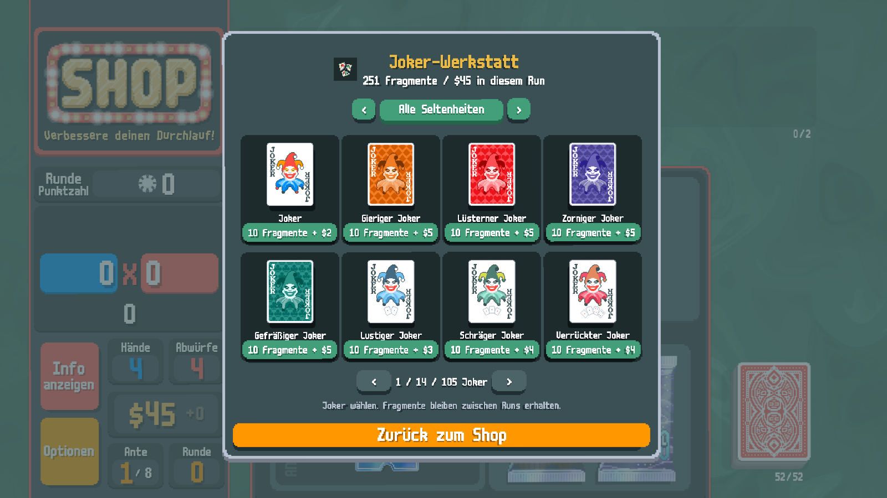
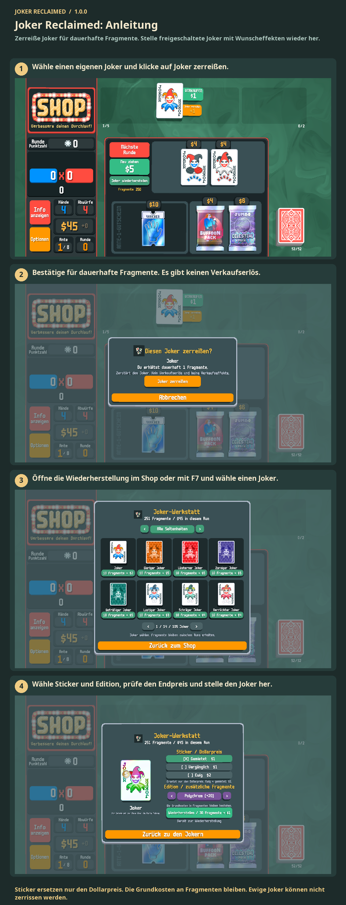

# Joker Reclaimed: Anleitung

Zerreiße Joker für dauerhafte Fragmente. Stelle freigeschaltete Joker mit Wunscheffekten wieder her.

Zerreiße Joker für Fragmente. Öffne die Wiederherstellung im Shop oder mit F7. Wähle Joker, Sticker und Edition; zahle mit Fragmenten und Geld des Laufs. Ewige Joker lassen sich nicht zerreißen.

1. Wähle einen eigenen Joker und klicke auf Joker zerreißen.
2. Bestätige für dauerhafte Fragmente. Es gibt keinen Verkaufserlös.
3. Öffne die Wiederherstellung im Shop oder mit F7 und wähle einen Joker.
4. Wähle Sticker und Edition, prüfe den Endpreis und stelle den Joker her.

Sticker ersetzen nur den Dollarpreis. Die Grundkosten an Fragmenten bleiben. Ewige Joker können nicht zerrissen werden.

[1](../images/screenshots/de-shop.png) · [2](../images/screenshots/de-tear.png) · [3](../images/screenshots/de-intro.png) · [4](../images/screenshots/de-options.png) · [✂](../images/screenshots/de-effect.png)
