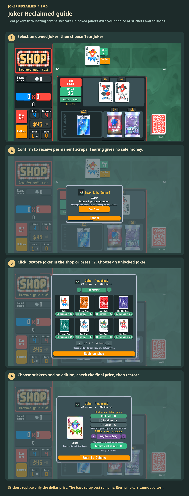

# Joker Reclaimed guide

Tear Jokers into lasting scraps. Restore unlocked Jokers with your choice of stickers and editions.

Select your Joker and click Tear Joker. In the shop, click Restore Joker or press F7. Choose a Joker, stickers and an edition, then pay with scraps and run money. Eternal Jokers cannot be torn.

1. Select an owned Joker, then choose Tear Joker.
2. Confirm to receive permanent scraps. Tearing gives no sale money.
3. Click Restore Joker in the shop or press F7. Choose an unlocked Joker.
4. Choose stickers and an edition, check the final price, then restore.

Stickers replace only the dollar price. The base scrap cost remains. Eternal Jokers cannot be torn.

[1](../images/screenshots/en-us-shop.png) · [2](../images/screenshots/en-us-tear.png) · [3](../images/screenshots/en-us-intro.png) · [4](../images/screenshots/en-us-options.png) · [✂](../images/screenshots/en-us-effect.png)
