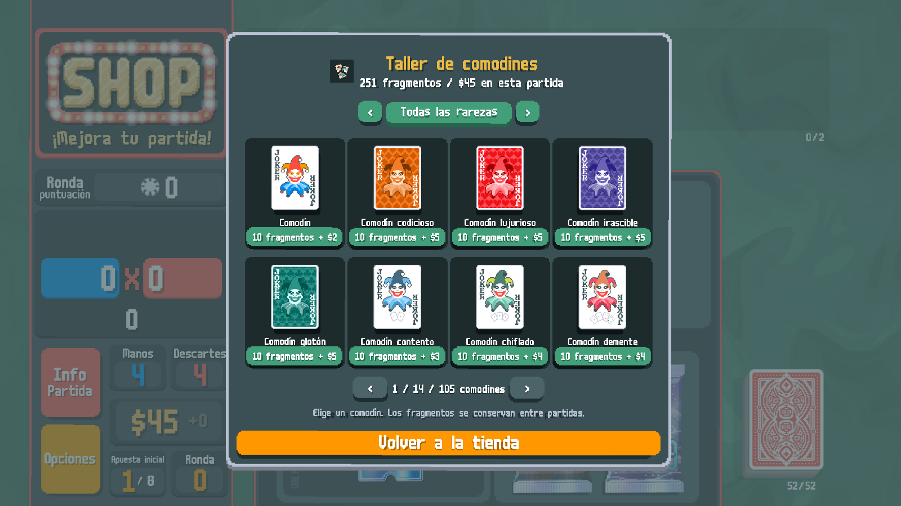
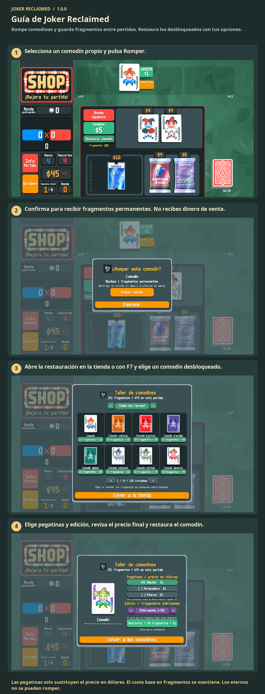

# Guía de Joker Reclaimed

Rompe comodines y guarda fragmentos entre partidas. Restaura los desbloqueados con tus opciones.

Rompe un comodín para obtener fragmentos. Abre la restauración en la tienda o con F7. Elige comodín, pegatinas y edición; paga con fragmentos y dinero de la partida. Los eternos no se pueden romper.

1. Selecciona un comodín propio y pulsa Romper.
2. Confirma para recibir fragmentos permanentes. No recibes dinero de venta.
3. Abre la restauración en la tienda o con F7 y elige un comodín desbloqueado.
4. Elige pegatinas y edición, revisa el precio final y restaura el comodín.

Las pegatinas solo sustituyen el precio en dólares. El coste base en fragmentos se mantiene. Los eternos no se pueden romper.

[1](../images/screenshots/es_ES-shop.png) · [2](../images/screenshots/es_ES-tear.png) · [3](../images/screenshots/es_ES-intro.png) · [4](../images/screenshots/es_ES-options.png) · [✂](../images/screenshots/es_ES-effect.png)
