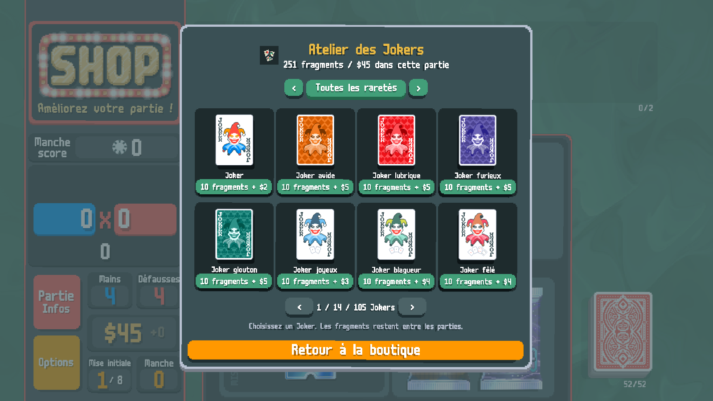
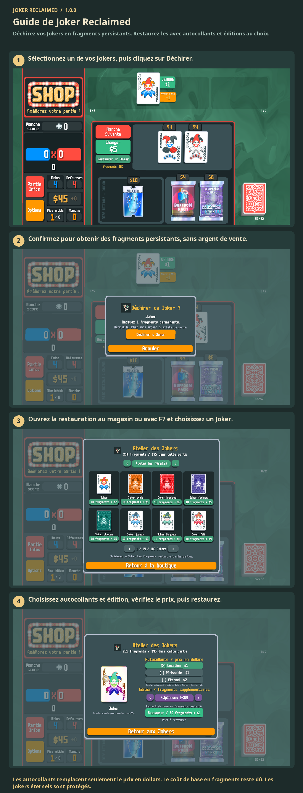

# Guide de Joker Reclaimed

Déchirez vos Jokers en fragments persistants. Restaurez-les avec autocollants et éditions au choix.

Déchirez un Joker pour des fragments. Au magasin, ouvrez la restauration ou appuyez sur F7. Choisissez Joker, autocollants et édition, puis payez. Les Jokers éternels ne peuvent pas être déchirés.

1. Sélectionnez un de vos Jokers, puis cliquez sur Déchirer.
2. Confirmez pour obtenir des fragments persistants, sans argent de vente.
3. Ouvrez la restauration au magasin ou avec F7 et choisissez un Joker.
4. Choisissez autocollants et édition, vérifiez le prix, puis restaurez.

Les autocollants remplacent seulement le prix en dollars. Le coût de base en fragments reste dû. Les Jokers éternels sont protégés.

[1](../images/screenshots/fr-shop.png) · [2](../images/screenshots/fr-tear.png) · [3](../images/screenshots/fr-intro.png) · [4](../images/screenshots/fr-options.png) · [✂](../images/screenshots/fr-effect.png)
