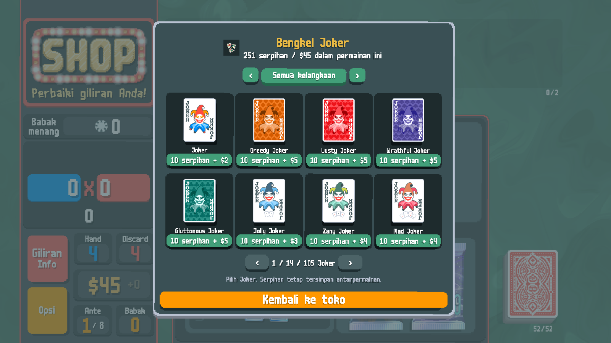
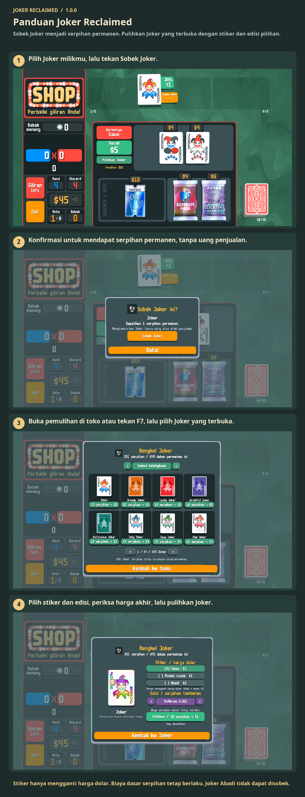

# Panduan Joker Reclaimed

Sobek Joker menjadi serpihan permanen. Pulihkan Joker yang terbuka dengan stiker dan edisi pilihan.

Sobek Joker milikmu untuk mendapat serpihan. Buka pemulihan di toko atau tekan F7. Pilih Joker, stiker, dan edisi, lalu bayar dengan serpihan dan uang permainan ini. Joker Abadi tak bisa disobek.

1. Pilih Joker milikmu, lalu tekan Sobek Joker.
2. Konfirmasi untuk mendapat serpihan permanen, tanpa uang penjualan.
3. Buka pemulihan di toko atau tekan F7, lalu pilih Joker yang terbuka.
4. Pilih stiker dan edisi, periksa harga akhir, lalu pulihkan Joker.

Stiker hanya mengganti harga dolar. Biaya dasar serpihan tetap berlaku. Joker Abadi tidak dapat disobek.

[1](../images/screenshots/id-shop.png) · [2](../images/screenshots/id-tear.png) · [3](../images/screenshots/id-intro.png) · [4](../images/screenshots/id-options.png) · [✂](../images/screenshots/id-effect.png)
