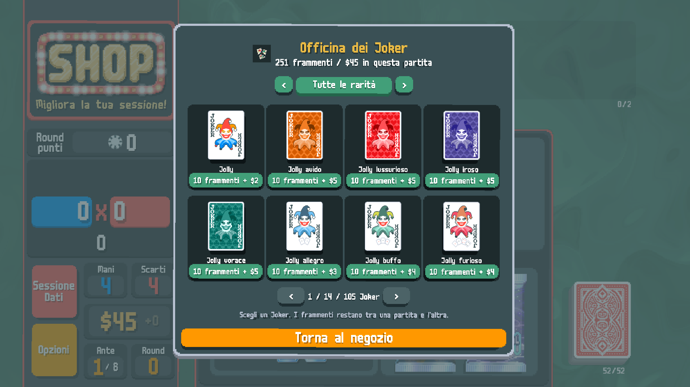
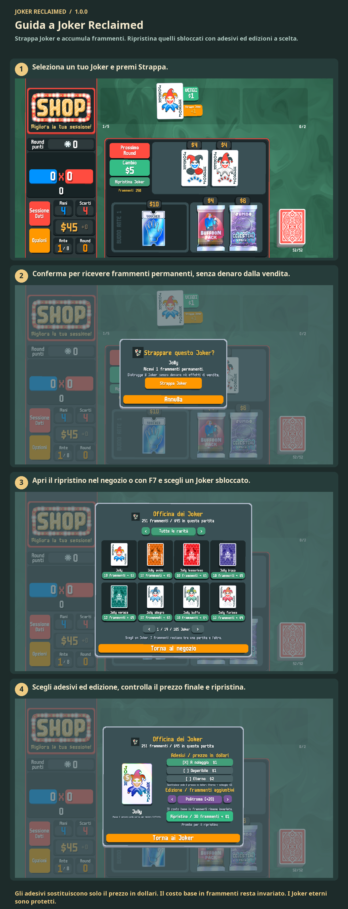

# Guida a Joker Reclaimed

Strappa Joker e accumula frammenti. Ripristina quelli sbloccati con adesivi ed edizioni a scelta.

Strappa un Joker per ottenere frammenti. Apri il ripristino nel negozio o con F7. Scegli Joker, adesivi ed edizione; paga con frammenti e denaro della partita. I Joker eterni non si possono strappare.

1. Seleziona un tuo Joker e premi Strappa.
2. Conferma per ricevere frammenti permanenti, senza denaro dalla vendita.
3. Apri il ripristino nel negozio o con F7 e scegli un Joker sbloccato.
4. Scegli adesivi ed edizione, controlla il prezzo finale e ripristina.

Gli adesivi sostituiscono solo il prezzo in dollari. Il costo base in frammenti resta invariato. I Joker eterni sono protetti.

[1](../images/screenshots/it-shop.png) · [2](../images/screenshots/it-tear.png) · [3](../images/screenshots/it-intro.png) · [4](../images/screenshots/it-options.png) · [✂](../images/screenshots/it-effect.png)
