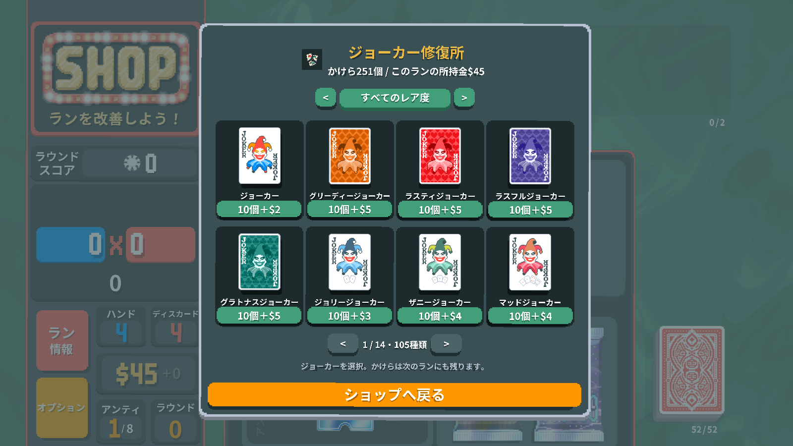
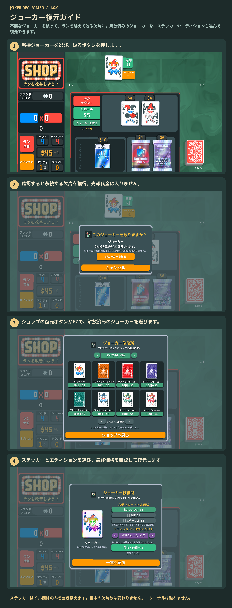

# ジョーカー復元ガイド

不要なジョーカーを破って、ランを越えて残る欠片に。解放済みのジョーカーを、ステッカーやエディションも選んで復元できます。

所持ジョーカーの「破る」で欠片を集めます。ショップの復元ボタンかF7を押し、ジョーカー・ステッカー・エディションを選択。欠片と現在のランのお金で復元できます。エターナルのジョーカーは破れません。

1. 所持ジョーカーを選び、破るボタンを押します。
2. 確認すると永続する欠片を獲得。売却代金は入りません。
3. ショップの復元ボタンかF7で、解放済みのジョーカーを選びます。
4. ステッカーとエディションを選び、最終価格を確認して復元します。

ステッカーはドル価格のみを置き換えます。基本の欠片数は変わりません。エターナルは破れません。

[1](../images/screenshots/ja-shop.png) · [2](../images/screenshots/ja-tear.png) · [3](../images/screenshots/ja-intro.png) · [4](../images/screenshots/ja-options.png) · [✂](../images/screenshots/ja-effect.png)
