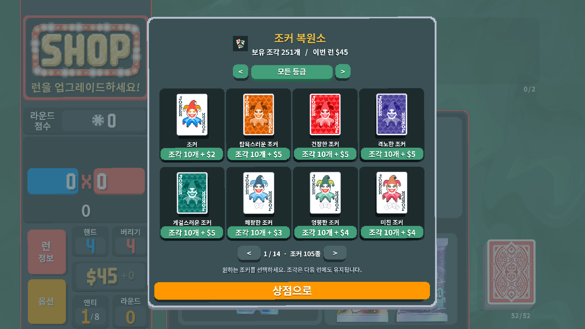
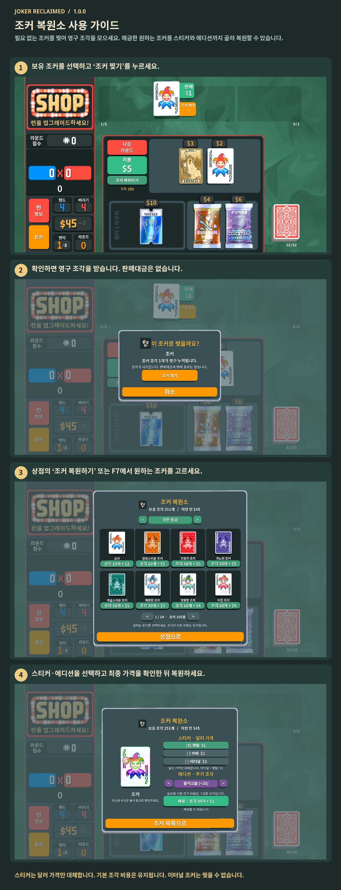

# 조커 복원소 사용 가이드

필요 없는 조커를 찢어 영구 조각을 모으세요. 해금한 원하는 조커를 스티커와 에디션까지 골라 복원할 수 있습니다.

보유 조커의 ‘조커 찢기’로 조각을 모으세요. 상점에서 ‘조커 복원하기’ 또는 F7을 누르고 조커·스티커·에디션을 선택한 뒤 조각과 이번 런의 돈으로 구매하세요. 이터널 조커는 찢을 수 없습니다.

1. 보유 조커를 선택하고 ‘조커 찢기’를 누르세요.
2. 확인하면 영구 조각을 받습니다. 판매대금은 없습니다.
3. 상점의 ‘조커 복원하기’ 또는 F7에서 원하는 조커를 고르세요.
4. 스티커·에디션을 선택하고 최종 가격을 확인한 뒤 복원하세요.

스티커는 달러 가격만 대체합니다. 기본 조각 비용은 유지됩니다. 이터널 조커는 찢을 수 없습니다.

[1](../images/screenshots/ko-shop.png) · [2](../images/screenshots/ko-tear.png) · [3](../images/screenshots/ko-intro.png) · [4](../images/screenshots/ko-options.png) · [✂](../images/screenshots/ko-effect.png)
