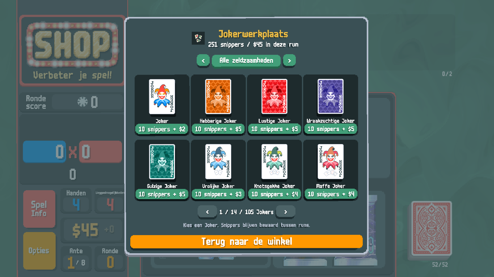
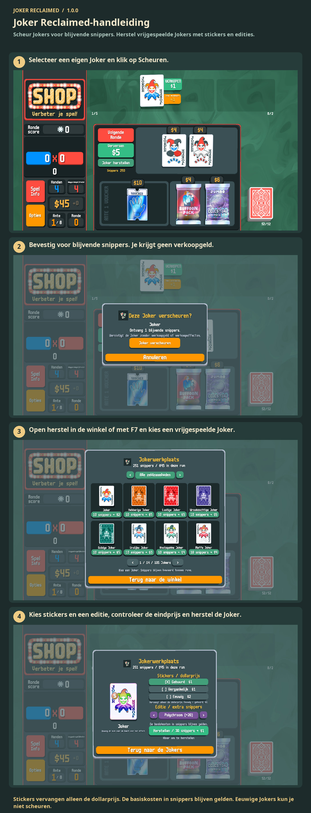

# Joker Reclaimed-handleiding

Scheur Jokers voor blijvende snippers. Herstel vrijgespeelde Jokers met stickers en edities.

Scheur een eigen Joker voor snippers. Open herstel in de winkel of druk op F7. Kies een Joker, stickers en editie; betaal met snippers en geld uit deze run. Eeuwige Jokers kun je niet scheuren.

1. Selecteer een eigen Joker en klik op Scheuren.
2. Bevestig voor blijvende snippers. Je krijgt geen verkoopgeld.
3. Open herstel in de winkel of met F7 en kies een vrijgespeelde Joker.
4. Kies stickers en een editie, controleer de eindprijs en herstel de Joker.

Stickers vervangen alleen de dollarprijs. De basiskosten in snippers blijven gelden. Eeuwige Jokers kun je niet scheuren.

[1](../images/screenshots/nl-shop.png) · [2](../images/screenshots/nl-tear.png) · [3](../images/screenshots/nl-intro.png) · [4](../images/screenshots/nl-options.png) · [✂](../images/screenshots/nl-effect.png)
