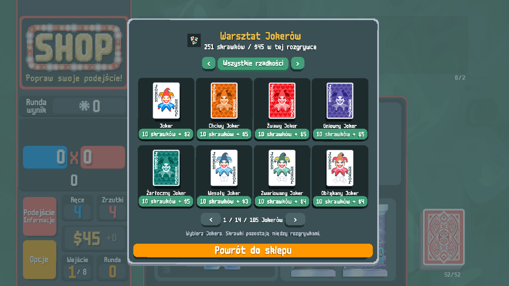
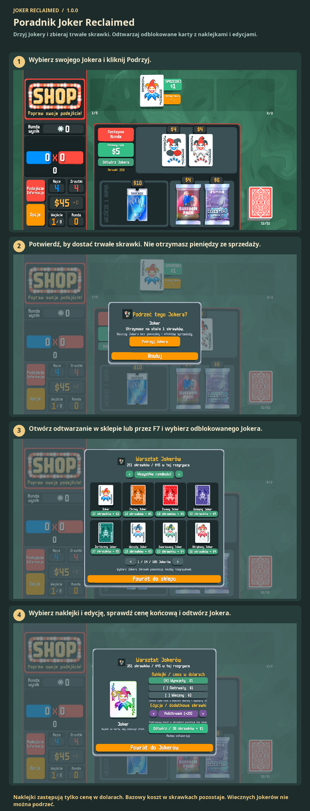

# Poradnik Joker Reclaimed

Drzyj Jokery i zbieraj trwałe skrawki. Odtwarzaj odblokowane karty z naklejkami i edycjami.

Podrzyj Jokera, by zdobyć skrawki. Otwórz odtwarzanie w sklepie lub naciśnij F7. Wybierz Jokera, naklejki i edycję; zapłać skrawkami i pieniędzmi z tej gry. Wiecznych Jokerów nie można podrzeć.

1. Wybierz swojego Jokera i kliknij Podrzyj.
2. Potwierdź, by dostać trwałe skrawki. Nie otrzymasz pieniędzy ze sprzedaży.
3. Otwórz odtwarzanie w sklepie lub przez F7 i wybierz odblokowanego Jokera.
4. Wybierz naklejki i edycję, sprawdź cenę końcową i odtwórz Jokera.

Naklejki zastępują tylko cenę w dolarach. Bazowy koszt w skrawkach pozostaje. Wiecznych Jokerów nie można podrzeć.

[1](../images/screenshots/pl-shop.png) · [2](../images/screenshots/pl-tear.png) · [3](../images/screenshots/pl-intro.png) · [4](../images/screenshots/pl-options.png) · [✂](../images/screenshots/pl-effect.png)
