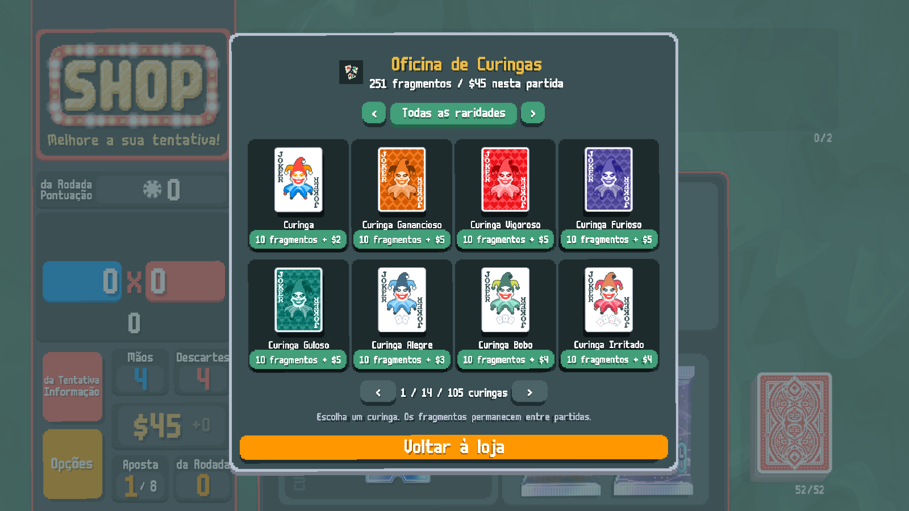
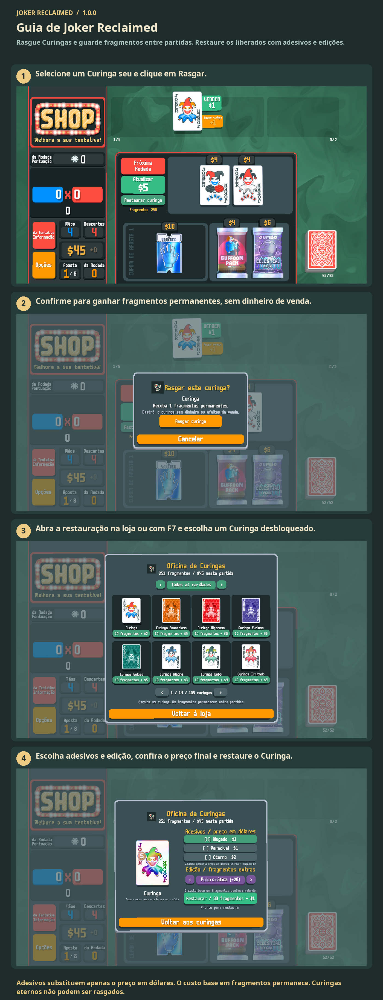

# Guia de Joker Reclaimed

Rasgue Curingas e guarde fragmentos entre partidas. Restaure os liberados com adesivos e edições.

Rasgue um Curinga para ganhar fragmentos. Abra a restauração na loja ou com F7. Escolha Curinga, adesivos e edição; pague com fragmentos e dinheiro da partida. Curingas eternos não podem ser rasgados.

1. Selecione um Curinga seu e clique em Rasgar.
2. Confirme para ganhar fragmentos permanentes, sem dinheiro de venda.
3. Abra a restauração na loja ou com F7 e escolha um Curinga desbloqueado.
4. Escolha adesivos e edição, confira o preço final e restaure o Curinga.

Adesivos substituem apenas o preço em dólares. O custo base em fragmentos permanece. Curingas eternos não podem ser rasgados.

[1](../images/screenshots/pt_BR-shop.png) · [2](../images/screenshots/pt_BR-tear.png) · [3](../images/screenshots/pt_BR-intro.png) · [4](../images/screenshots/pt_BR-options.png) · [✂](../images/screenshots/pt_BR-effect.png)
