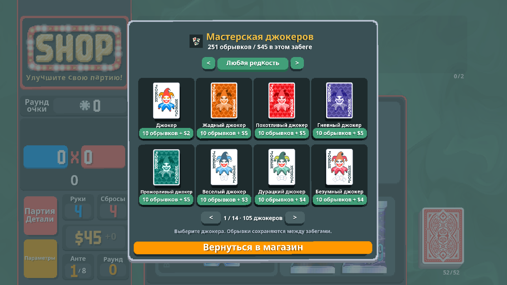
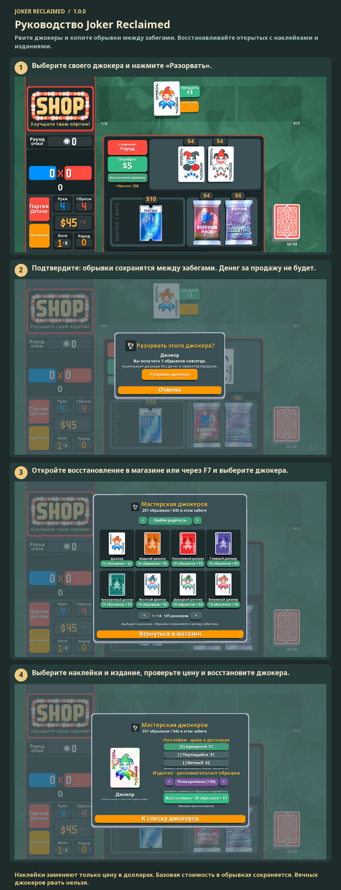

# Руководство Joker Reclaimed

Рвите джокеры и копите обрывки между забегами. Восстанавливайте открытых с наклейками и изданиями.

Разорвите своего джокера ради обрывков. Откройте восстановление в магазине или нажмите F7. Выберите джокера, наклейки и издание; заплатите обрывками и деньгами забега. Вечных джокеров рвать нельзя.

1. Выберите своего джокера и нажмите «Разорвать».
2. Подтвердите: обрывки сохранятся между забегами. Денег за продажу не будет.
3. Откройте восстановление в магазине или через F7 и выберите джокера.
4. Выберите наклейки и издание, проверьте цену и восстановите джокера.

Наклейки заменяют только цену в долларах. Базовая стоимость в обрывках сохраняется. Вечных джокеров рвать нельзя.

[1](../images/screenshots/ru-shop.png) · [2](../images/screenshots/ru-tear.png) · [3](../images/screenshots/ru-intro.png) · [4](../images/screenshots/ru-options.png) · [✂](../images/screenshots/ru-effect.png)
