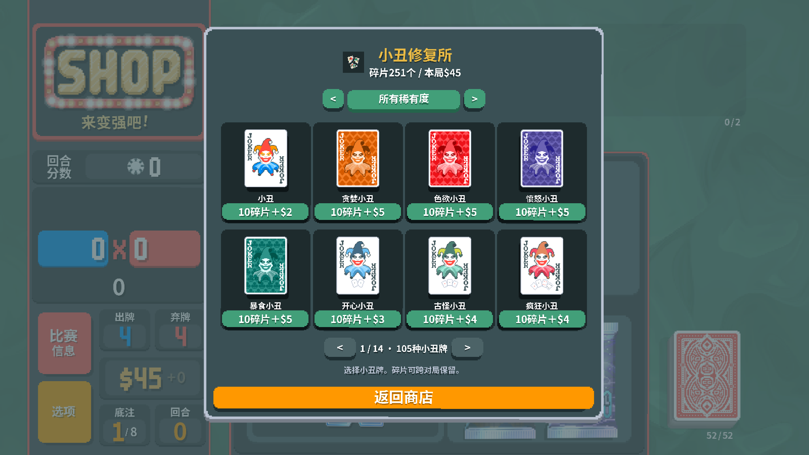
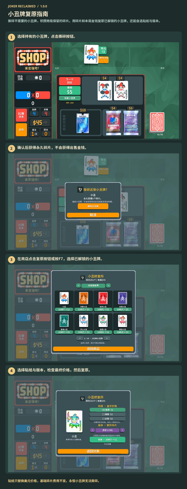

# 小丑牌复原指南

撕碎不需要的小丑牌，积攒跨局保留的碎片。用碎片和本局金钱复原已解锁的小丑牌，还能自选贴纸与版本。

选择持有的小丑牌并点击撕碎，获得永久碎片。在商店点击复原按钮或按F7，选择已解锁的小丑牌、贴纸和版本，确认价格后用碎片与本局金钱购买。永恒小丑牌无法撕碎。

1. 选择持有的小丑牌，点击撕碎按钮。
2. 确认后获得永久碎片，不会获得出售金钱。
3. 在商店点击复原按钮或按F7，选择已解锁的小丑牌。
4. 选择贴纸与版本，检查最终价格，然后复原。

贴纸只替换美元价格，基础碎片费用不变。永恒小丑牌无法撕碎。

[1](../images/screenshots/zh_CN-shop.png) · [2](../images/screenshots/zh_CN-tear.png) · [3](../images/screenshots/zh_CN-intro.png) · [4](../images/screenshots/zh_CN-options.png) · [✂](../images/screenshots/zh_CN-effect.png)
