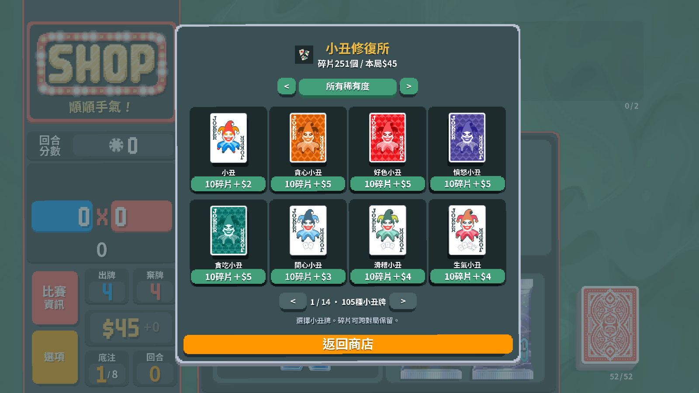
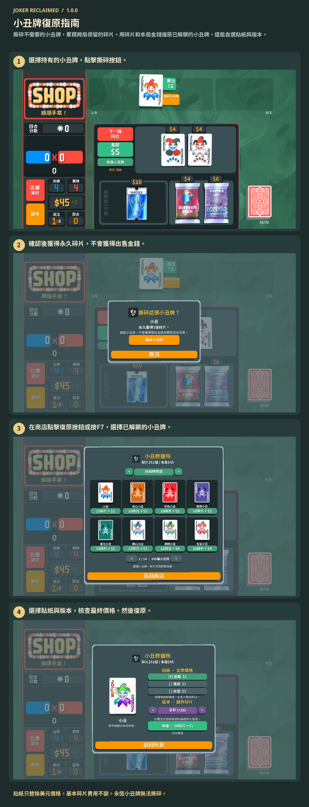

# 小丑牌復原指南

撕碎不需要的小丑牌，累積跨局保留的碎片。用碎片和本局金錢復原已解鎖的小丑牌，還能自選貼紙與版本。

選擇持有的小丑牌並點擊撕碎，獲得永久碎片。在商店點擊復原按鈕或按F7，選擇已解鎖的小丑牌、貼紙和版本，確認價格後用碎片與本局金錢購買。永恆小丑牌無法撕碎。

1. 選擇持有的小丑牌，點擊撕碎按鈕。
2. 確認後獲得永久碎片，不會獲得出售金錢。
3. 在商店點擊復原按鈕或按F7，選擇已解鎖的小丑牌。
4. 選擇貼紙與版本，檢查最終價格，然後復原。

貼紙只替換美元價格，基本碎片費用不變。永恆小丑牌無法撕碎。

[1](../images/screenshots/zh_TW-shop.png) · [2](../images/screenshots/zh_TW-tear.png) · [3](../images/screenshots/zh_TW-intro.png) · [4](../images/screenshots/zh_TW-options.png) · [✂](../images/screenshots/zh_TW-effect.png)
